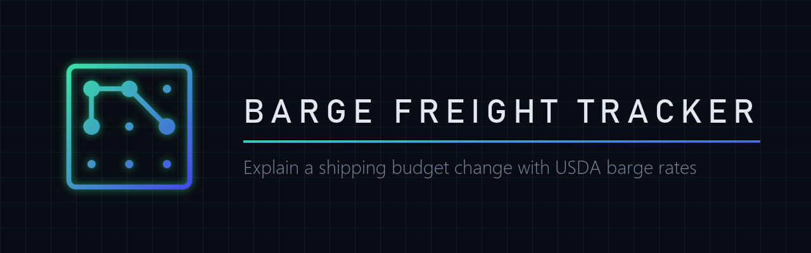
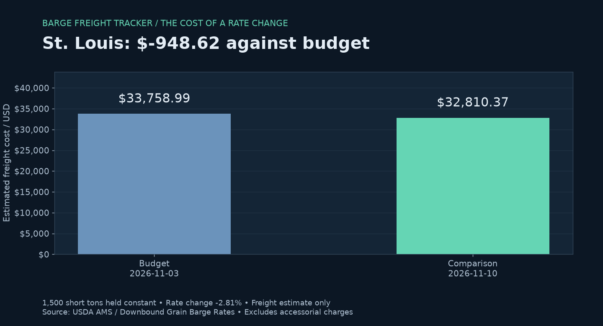
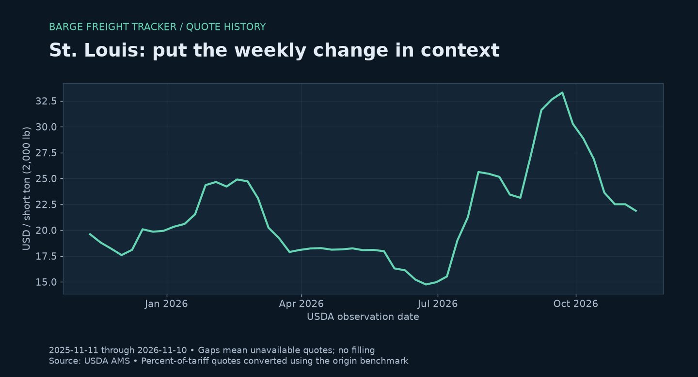
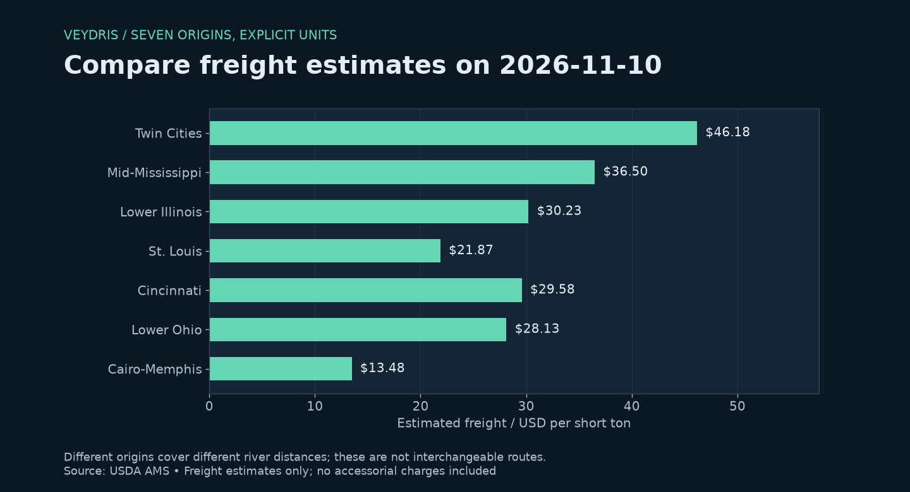

Barge Freight Budget Tracker — explain a shipping budget change using public USDA river freight rates.

# Barge Freight Tracker

How much has river freight changed your shipping budget? Barge Freight Tracker turns weekly percent-of-tariff quotes into freight estimates, compares two exact observation dates at a fixed shipment volume, and exports an offline interactive HTML report and variance CSV.

A grain logistics analyst can use it to explain the rate portion of a budget change. Every result states the dates and units used. Missing quotes stay unavailable, so a report cannot silently substitute a different week.

## Quick start

Requires Python 3.12. Only chart generation needs a third-party package: Matplotlib. The calculator, downloader and HTML report use Python's standard library. No API key, server, account or live request is needed for the demo.

Windows PowerShell, from the project folder:

```powershell
python -m venv .venv
.venv\Scripts\python.exe -m pip install -r requirements.txt
.venv\Scripts\python.exe -m unittest -v
.venv\Scripts\python.exe -m barge_freight
Start-Process output/report.html
```

On macOS/Linux, use `python3 -m venv .venv`, then replace `.venv\Scripts\python.exe` with `.venv/bin/python` in the commands above. Open `output/report.html` in your browser.

The [bundled report](docs/report.html) can also be downloaded and opened directly. It contains its own data, styles, scripts and SVG chart; it uses no CDN. Select an origin, enter short tons, choose observation dates, and download the resulting variance CSV. The observation table and date menus identify unavailable quotes explicitly.

### Example

```powershell
.venv\Scripts\python.exe -m barge_freight --origin "St. Louis" --tons 1500 --budget 2026-11-03 --comparison 2026-11-10
```

```text
St. Louis: 2026-11-03 -> 2026-11-10 | 1500 short tons
Freight estimate: $33,758.99 -> $32,810.37
Budget variance: $-948.62 (-2.81%)
Report: output\report.html
```

The negative variance means the comparison estimate is **$948.62 below budget**, with 1,500 short tons held constant. `output/report.csv` contains exact per-ton rates, shipment volume, dates, estimated costs, variance and percentage change. Omitting dates selects the last two observation dates in the input, even when a quote is unavailable; it never searches backward for a usable quote.

## Showcase

Regenerate all three 1,440 × 780 PNGs and the bundled HTML report offline:

```powershell
.venv\Scripts\python.exe -m barge_freight --output docs/report.html --showcase docs/showcase
```



At a fixed 1,500 short tons, the St. Louis rate change reduces the freight estimate by $948.62.



A year of observed St. Louis freight estimates puts the latest weekly change in context.



Seven origin estimates share explicit dollar-per-short-ton units while covering different river distances.

## How it works

1. Read the bundled USDA CSV, validate observation dates and origin names, reject duplicates and invalid numeric rates, and retain blank quotes.
2. Look up the origin's 1976 benchmark in the sourced [reference CSV](data/benchmarks.csv).
3. Calculate `USD per short ton = quote percent / 100 × benchmark USD per short ton`.
4. Multiply each unrounded rate by the same shipment volume, round each estimated shipment cost to cents with half-up rounding, then subtract budget cost from comparison cost.
5. Calculate percentage change from the unrounded rates: `(comparison / budget - 1) × 100`. A zero budget rate makes this percentage undefined.
6. Export the HTML report and CSV. Matplotlib renders the same observations and estimates for the showcase images.

One short ton is **2,000 pounds**, not a metric tonne. USDA's worked example is 200% × the Twin Cities benchmark of $6.19 = **$12.38 per short ton**. Benchmarks printed as `619` in USDA's reference mean cents, not $619. [USDA's explanation](https://www.ams.usda.gov/sites/default/files/media/Explanation%20of%20Barge%20Rates.pdf) and [source notes](data/SOURCES.md) document every origin mapping and the data's provenance.

Python uses `Decimal` for arithmetic. The browser uses integer fractions (`BigInt`) to match Python's cent rounding, including fractional tonnage. The rate effect is isolated by holding volume fixed; this first version does not explain a simultaneous volume change. Its variance reconciles the two displayed shipment costs, so it can differ by one cent from rounding the unrounded rate difference times volume.

## Data and refresh

The bundled public snapshot has **371 records**, seven origins, and 21 missing quotes, with observations from **2025-11-11 through 2026-11-10**. Retrieval time, source URL, row counts and SHA-256 checksums are in [sample.json](data/sample.json). [USDA AMS publishes the dataset](https://agtransport.usda.gov/Barge/Downbound-Grain-Barge-Rates/deqi-uken).

Fetch the complete public export and replace the dated demo sample:

```powershell
.venv\Scripts\python.exe -m barge_freight --refresh
```

This is the only command that needs network access. Full downloads go in gitignored `data/raw/`. The refresh validates the complete export, then keeps all rows from the latest 366-day window. Download or validation failure leaves the previous sample intact. Historical committed versions remain available through Git. Inspect the source metadata and rerun tests and showcase generation before adopting a refresh.

To analyze a complete download or another CSV with the same USDA schema, pass `--data data/raw/usda.csv`. Custom CSVs without a matching metadata checksum are labeled as having unverified retrieval time. Dates absent from an origin are unavailable; expected weekly gaps are included in report menus and charts without filling rates.

GitHub Actions runs offline tests and generates report artifacts on pushes and pull requests. A weekly Wednesday public-data refresh is configured for the initial maintenance window ending **2026-11-22 UTC**. It uploads a validated snapshot artifact for review and retains the checked-in snapshot if the job fails; it does not commit replacements. Scheduling starts only after the repository is published with Actions enabled, and GitHub may delay scheduled runs. After the window, extend the date in `refresh.yml` deliberately to enable future refreshes.

## Dependency troubleshooting

Run diagnostics with the same Python interpreter you use for the app:

```powershell
.venv\Scripts\python.exe -m barge_freight --doctor
```

On macOS/Linux, use `.venv/bin/python -m barge_freight --doctor`.
The command shows the active interpreter, checks Python 3.12 and Matplotlib
(`>=3.9,<4`), and renders a tiny PNG in memory to catch broken chart dependencies.
It works even when Matplotlib is missing. A failed check includes details and,
for chart failures, an install command using that exact interpreter. In PowerShell,
prefix a quoted executable path with `&`. Run the suggested command yourself if
you want to install dependencies; installation requires access to a package source.

When the chart check fails, diagnostics also run `pip --version` with the same
interpreter. If pip is missing, broken or cannot finish, the output suggests
`-m ensurepip --upgrade` before the install command. This restores Python's bundled
pip when available; otherwise, recreate the environment with a Python 3.12
distribution that includes pip. Both commands are suggestions for you to run.
The pip probe is offline and has a 30-second timeout, as does the chart probe.

Diagnostics use no network, install nothing, and leave your data and reports
untouched. Chart caches go in a temporary directory that is removed afterward.
Exit status is **0** when all checks pass and **1** when attention is needed.
`--doctor` takes priority over `--refresh` and report options, so combining them
only runs diagnostics. Missing chart dependencies do not prevent the calculator,
CSV export or offline HTML report from working; they are only needed for `--showcase`.
Node.js is optional for browser logic tests and is not required by the application.

## Tests and interview walkthrough

```powershell
.venv\Scripts\python.exe -m unittest -v
```

The offline suite checks both USDA worked conversions, every origin benchmark, known shipment arithmetic, rounding, invalid volumes, duplicate records, missing quotes, missing weeks, zero baselines, CSV/report output, refresh failure preservation, source hashes and PNG dimensions. Dated regression cases use a frozen public USDA fixture; separate checks validate the refreshable sample against its metadata. If Node.js is available, the suite also executes the shipped report's JavaScript and compares hundreds of fractional-volume calculations and CSV exports against Python. That logic test uses a small DOM stand-in; it does not verify browser layout. Node.js is optional and no npm packages are needed.

For an interview, start with the 271% St. Louis quote: explain why the benchmark is $3.99, show the unrounded $10.8129 rate, then multiply by shipment tons. Open the report, change the tonnage, and explain why both estimates change while the percentage rate change stays fixed. Choose an unavailable Twin Cities winter week to demonstrate why a missing rate cannot be treated as zero. Finish with the source notes and the test that verifies browser/Python agreement.

## Limitations

These are **freight estimates**, not carrier quotes or all-in landed costs. Fuel surcharges, loading, unloading, storage, insurance, demurrage and other accessorial charges are excluded. Routes from different origins have different distances and are not interchangeable purchasing alternatives. There is no forecast, causal attribution of market changes, capacity model, shipment tracking or contract pricing.

The demo is a frozen sample; refresh manually when current data is required. Missing weeks are not interpolated. Expected weekly gaps are derived from the first observation's weekday; unusual off-cycle observations are retained alongside that grid. Browser output requires JavaScript with BigInt support. The browser logic is tested offline, but a connected browser was unavailable for a visual layout test during this build. No automated refresh has run on GitHub yet.

The application code is MIT licensed, copyright Rohit Malla. Public USDA data retains its source attribution; USDA does not endorse this project.
